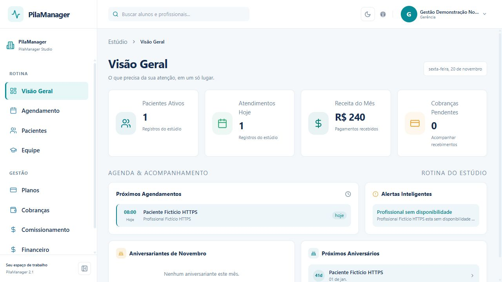

# PilaManager

Sistema de gestão para estúdios de Pilates, desenvolvido durante o semestre. Reúne pacientes, equipe, agenda, planos, cobranças, comissões e relatórios.

## Links

- [Acessar o sistema](https://pilamanager-web-production.up.railway.app/)
- [Quadro do Trello](https://trello.com/b/tFTm4z72/pilamanager-21)
- [GitHub do projeto](https://github.com/LuizHenriqueSantetti/pilamanager-nova-experiencia-postgres)

## Como funciona

O paciente pode ser cadastrado com um plano, que gera o vínculo e a cobrança. A agenda considera os horários dos profissionais. Os recebimentos e as comissões aparecem no Financeiro e podem ser consultados nos relatórios em PDF.

Cada conta tem um perfil de acesso. A aplicação funciona no computador e no celular e tem modo claro e escuro.

## Ferramentas

Trello para organizar as tarefas, Figma Make na base do protótipo, Git e GitHub para guardar o código e Railway para publicar a aplicação.

O sistema usa TypeScript, React, Next.js, Node.js e Tailwind CSS. O banco atual é PostgreSQL. ChatGPT e Codex foram usados como apoio ao desenvolvimento e aos testes.

## Documentação

- [Ferramentas utilizadas](docs/FERRAMENTAS.md)
- [Banco de dados](docs/BANCO_DE_DADOS.md)
- [Como executar no computador](docs/COMO_RODAR.md)
- [Publicação e backup](docs/OPERACAO.md)
- [Testes realizados](docs/TESTES.md)

## Pastas principais

| Pasta | Conteúdo |
| --- | --- |
| `src/app` | Telas e regras de uso. |
| `app/api` e `src/server` | Pedidos ao servidor, acesso e gravação dos dados. |
| `postgres` | Estrutura do banco atual. |
| `tests` | Testes automatizados. |
| `scripts` | Rotinas de banco, publicação e backup. |
| `docs` | Documentação e imagem do sistema. |

A publicação é uma demonstração com dados fictícios e exige uma conta autorizada.

Projeto de **Luiz Henrique Santetti**. [Créditos da base visual](ATTRIBUTIONS.md).
